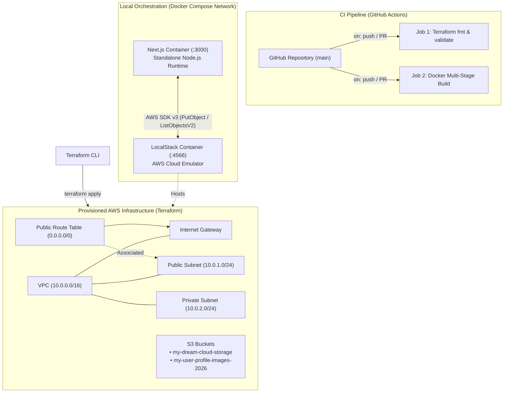

# ☁️ End-to-End Cloud Infrastructure & Containerized Web App


A production-inspired cloud engineering portfolio project demonstrating **Infrastructure as Code (IaC)**, **network segmentation**, **multi-stage containerization**, **cloud-native SDK integration**, and **automated CI pipelines**—engineered to run locally at zero cloud cost using **LocalStack**.

---

## 🏗️ System Architecture



---

## ✨ Key Cloud Engineering Highlights

* **Infrastructure as Code (Terraform):** Provisioned isolated AWS networking (`VPC`, `Public/Private Subnets`, `Internet Gateway`, `Route Tables`) and `S3` storage buckets declaratively using implicit resource dependencies.
* **Network Isolation Design:** Segregated public-facing resources (`10.0.1.0/24` with IGW route `0.0.0.0/0`) from isolated private workloads (`10.0.2.0/24`).
* **Optimized Multi-Stage Docker Build:** Built a 3-stage `Dockerfile` (`deps` → `builder` → `runner`) using `node:20-alpine` and Next.js `standalone` output, significantly minimizing image size and attack surface.
* **12-Factor App Configuration:** Decoupled environment configuration via `AWS_ENDPOINT_URL`, allowing the exact same container image to switch seamlessly between LocalStack and production AWS without code changes.
* **Service Orchestration & Health Checks:** Orchestrated multi-container networking via `docker-compose.yml` and implemented a `/api/health` endpoint for container readiness/liveness monitoring.
* **Automated CI Pipeline:** Configured parallel GitHub Actions jobs to enforce `terraform fmt -check`, `terraform validate`, and container image build verification on every push.

---

## 📂 Project Structure

```text
cloud-practice/
├── .github/
│   └── workflows/
│       └── ci.yml              # Automated Terraform validation & Docker build checks
├── my-nextjs-app/
│   ├── src/app/
│   │   ├── api/
│   │   │   ├── health/route.ts # Container health-check endpoint
│   │   │   └── s3-test/route.ts# AWS SDK v3 S3 upload & list handlers
│   │   └── page.tsx            # Frontend UI for testing S3 operations
│   ├── Dockerfile              # Multi-stage production container definition
│   └── next.config.ts          # Configured with output: "standalone"
├── docker-compose.yml          # Multi-container local stack orchestration
├── main.tf                     # AWS/LocalStack provider & S3 bucket resources
├── network.tf                  # VPC, Subnets, IGW, Route Tables & Outputs
└── .gitignore                  # Excludes secrets (.env), state files, and build artifacts
```

---

## 🚀 Quick Start Guide

### Prerequisites
* [Docker & Docker Compose](https://docs.docker.com/get-docker/)
* [Terraform CLI](https://developer.hashicorp.com/terraform/downloads)
* A free [LocalStack Auth Token](https://app.localstack.cloud/)

### 1. Configure Local Environment
Clone the repository and create a `.env` file in the root directory:
```bash
git clone [https://github.com/raviponcodemonday/nextjs-terraform-localstack-cloud.git](https://github.com/raviponcodemonday/nextjs-terraform-localstack-cloud.git)
cd nextjs-terraform-localstack-cloud
echo "LOCALSTACK_AUTH_TOKEN=your_token_here" > .env
```

### 2. Start Containers (LocalStack + Next.js)
```bash
docker compose up -d --build
```

### 3. Provision Cloud Infrastructure with Terraform
```bash
terraform init
terraform apply -auto-approve
```

### 4. Verify & Test
* **Web Application:** Open [http://localhost:3000](http://localhost:3000) and click **"+ สร้างและอัปโหลดไฟล์ขึ้น S3"** to upload objects and list bucket contents in real time.
* **Health Check Endpoint:** Open [http://localhost:3000/api/health](http://localhost:3000/api/health) to verify container status.
* **Raw S3 Bucket XML:** Inspect [http://localhost:4566/my-dream-cloud-storage](http://localhost:4566/my-dream-cloud-storage) directly on LocalStack.

### 5. Teardown
```bash
terraform destroy -auto-approve
docker compose down
```

---

## 🔮 Future Enhancements
* Configure **Remote Terraform State** using an S3 backend with DynamoDB state locking.
* Add **Security Groups & NACLs** in `network.tf` for granular Layer 4 traffic filtering.
* Extend GitHub Actions CD pipeline to push images to **Amazon ECR** and deploy to **AWS ECS Fargate**.